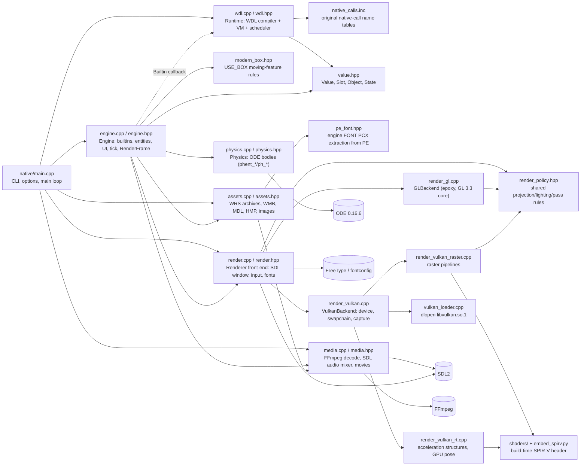
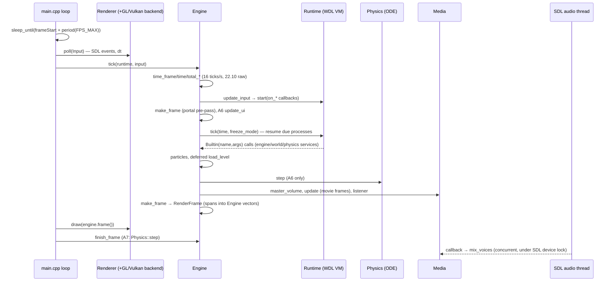

# Engine architecture (native Linux port)

Purpose: module map, frame loop, threading, simulation/renderer split and backend policy of the C++20 reimplementation in `native/` and the GTK tools in `installer/`, as read from current source (2026-10-09).

Related: [REVERSE_ENGINEERING.md](REVERSE_ENGINEERING.md) (index/methodology) · [reverse-engineering/SCRIPT_SYSTEM.md](reverse-engineering/SCRIPT_SYSTEM.md) · [reverse-engineering/FUNCTION_MAP.md](reverse-engineering/FUNCTION_MAP.md) · [ASSET_FORMATS.md](ASSET_FORMATS.md) · [CAMERA_SYSTEM.md](CAMERA_SYSTEM.md) · [GAMEPLAY_SYSTEMS.md](GAMEPLAY_SYSTEMS.md) · [reverse-engineering/ORIGINAL_BEHAVIOR.md](reverse-engineering/ORIGINAL_BEHAVIOR.md)

Confidence labels: **CONFIRMED** (read in source, decompiled code or run evidence), **HIGH CONFIDENCE**, **HYPOTHESIS**, **UNKNOWN**. "Original" means K22.exe (A6 6.31.4 campaign) or the A7 `acknex.dll` used by Bonus mode (`Kabus 22 Mode/K22_mode.wrs`); "native" means this port. Source citations are `file:symbol` (line numbers are as of reading; the files have very long lines and are being edited concurrently).

## 1. Build targets and external dependencies

| Target | Sources | Links | Evidence |
|---|---|---|---|
| `kabus22_core` (static lib) | `native/engine.cpp wdl.cpp assets.cpp render.cpp render_gl.cpp render_vulkan.cpp render_vulkan_raster.cpp render_vulkan_rt.cpp vulkan_loader.cpp media.cpp physics.cpp` + generated `render_vulkan_spirv.hpp` | SDL2, libepoxy (GL loader), libavformat/avcodec/avutil/swscale/swresample, FreeType, fontconfig, Threads, ODE (static), `dl` | `CMakeLists.txt` — **CONFIRMED** |
| `kabus22` (engine executable) | `native/main.cpp` | `kabus22_core` | `CMakeLists.txt` — **CONFIRMED** |
| Tests | `wdl_regression`, `check_assets`, `check_media` (media.cpp+assets.cpp with `K22_MEDIA_SELF_CHECK`), `check_engine`, `k22-render-check`, `check_physics` | `kabus22_core` | `CMakeLists.txt` (§9) — **CONFIRMED** |
| `kabus22-setup`, `kabus22_setup_core` | `installer/main.cpp`, `setup.cpp`, `media.cpp` | GTK3, libavcodec/avutil/swscale, libarchive, Threads | `installer/CMakeLists.txt` — **CONFIRMED** |
| `kabus22-launcher` | `installer/launcher.cpp`, `launcher_settings.cpp` | GTK3 | `installer/CMakeLists.txt` — **CONFIRMED** |
| `kabus22_layout` (static lib) | `installer/layout.cpp` | — (not yet linked by any executable at time of reading) | `installer/CMakeLists.txt` — **CONFIRMED**; see §10 |

- ODE: pinned upstream 0.16.6 (commit `a5fc0bc2…`), static, single precision, OPCODE trimesh, no GIMPACT/libccd (`cmake/KabusODE.cmake`) — **CONFIRMED**.
- Shaders: `native/shaders/*.{vert,frag,geom,comp}` are compiled by `glslangValidator --target-env vulkan1.2` at build time; `scene.frag` is compiled a second time with `-DK22_RAY_QUERY=1` into `scene.rt.frag.spv`; `native/embed_spirv.py` emits aligned `uint32_t` arrays in namespace `k22::vk22::spirv`. No shader files are read at runtime (`CMakeLists.txt`, `embed_spirv.py`) — **CONFIRMED**. These SPIR-V modules serve Vulkan only; the OpenGL backend carries its own inline GLSL strings (12 `#version` occurrences in `native/render_gl.cpp`) — **CONFIRMED**.
- Vulkan is a build dependency but not a link dependency: `native/vulkan_loader.cpp:load_vulkan` `dlopen`s `libvulkan.so.1` only when the Vulkan backend is constructed, with `VK_NO_PROTOTYPES` and an explicit entry-point table (`vulkan_loader.hpp:K22_VULKAN_FUNCTIONS`); a missing loader or entry point throws — **CONFIRMED**.

## 2. Module map

Notes: `engine.hpp` includes `assets.hpp`, `render.hpp`, `media.hpp`, `physics.hpp`; `wdl.cpp` includes `native_calls.inc`; `assets.cpp` includes `pe_font.hpp`; `engine.cpp` includes `modern_box.hpp` (grep of `#include`) — **CONFIRMED**. The `assets --> media` edge is `decode_image`/`decode_bitmap_font`, declared in `media.hpp` — **HIGH CONFIDENCE** (declaration location confirmed; call sites not enumerated).

### 2.1 Per-module responsibilities

| Module | Responsibility | Key types / functions (verified by grep) | Depends on |
|---|---|---|---|
| `native/main.cpp` | Parses CLI (`--data`, `--mode campaign\|bonus`, `--script`, `--display native\|authored`, `--resolution`, `--window-mode`, `--language`, `--audio-language`, `--define`, `--renderer opengl\|vulkan`, `--ray-tracing on\|off`, `--headless`, `--frames`, `--capture`); validates combinations; mounts archives (`K22_mode.wrs` for Bonus; `K22.wrs`, `Kaynak.k22`, `K22Widescreen.wrs` if present for campaign); picks entry WDL; sets compiler macros (`defiae_d3d`, `defses_<audio>`, `defdil_<lang>`, Bonus `defmode_d3d`, `defanti_N`); builds Renderer/Media/State/Engine/Runtime; runs the frame loop (§3) | `main`, `private_bonus_locale`, `resolution`, `help` | everything below |
| `native/value.hpp` | WDL value model: 32-bit raw word tagged `Number/Object/Function/NativeText`; numbers are 22.10 fixed point (`from_int` = ×1024); `Slot`, `Ref` (bit-mask refs), `Argument`; `Object` with `Kind {Name,String,Vector,Bmap,Sound,Font,Entity,Panel,Text,View,Material,Window,Particle,NativeText}`; `State` = globals + object store with never-reused handles (`handles` tombstone table, `freePayloads` recycling), leases (`retain_object`/`release_object`), `SemanticProfile {CampaignA6,BonusA7}` | `Value`, `Object`, `State::create/retire/require`, `ProcessContext` | std only |
| `native/wdl.cpp/.hpp` | WDL front end (lexer, preprocessor incl. `DEFINE`/includes, parser to `Expr` trees and per-function `Instruction` lists `Eval/Jump/Branch/Declare/Return/Late`) and VM: `Process` records with `pc`, locals, my/you context, countdown; double-buffered scheduler; `wait`/`waitt`/`sleep`/`proc_late`/`proc_kill` intrinsics; everything else dispatched to the host `Builtin` callback | `Runtime::{load,load_text,start,enqueue,bootstrap,tick,kill_for_entity}`, `Runtime::Impl::{lex,preprocess,parse,initialize,run,tick}`, `native_call_name` | `value.hpp`, `native_calls.inc` |
| `native/native_calls.inc` | Generated sorted tables `commonNativeCalls`, `campaignNativeCalls`, `bonusNativeCalls` from original descriptor rows (campaign `0061c408..0061d7d8`, 317 names; Bonus `101a8200..101a9aa0`, 392 names); used by `native_call_name` to classify call names per profile | — | `reverse/decompiled/runtime/api-descriptors.json` |
| `native/engine.cpp/.hpp` | Host side of every original native call; entity/view/panel/text/material registries and their per-object native data; input → script globals; UI layout and buttons; level loading; legacy and modern collision (`c_move`, `c_trace` in `world_builtin`); particles; file/INI services; Discord-IPC emulation for the community-patch script (`discordSocket` members); builds the per-frame `RenderFrame` | `Engine::{builtin,service_builtin,world_builtin,tick,finish_frame,prepare,load_level,create_entity,remove_entity,collide,make_frame,update_input,update_ui}`; `EntityData`, `Engine::Hit`, `entities` map | value, assets, render, media, physics, modern_box |
| `native/modern_box.hpp` | A6 `00585f60` / A7 `100b2680` USE_BOX moving-feature rules (oriented affine-normalized sphere, not SAT box) | `k22::modern_box::inside` etc. | assets types |
| `native/physics.cpp/.hpp` | ODE world for `ph_*`/`phent_*` calls; fixed-step accumulator; contact collection/reduction; bodies mirrored to entities | `Physics::{builtin,step,load_world,remove_entity,query_body_geometry,near_callback}` | ODE, Engine (friend) |
| `native/assets.cpp/.hpp` | Loose files + WRS archive mounts (`Assets::mount`, `decompress`); decoders for WMB worlds (`World`, BSP/hull/lightmap data), MDL/HMP models (`Model`), images; native lightmap LUTs; engine font from PE | `Assets::{mount,contains,read,model,world,image,image_ptr,purge_*,release_level}` | media (image decode), `pe_font.hpp` |
| `native/pe_font.hpp` | Validates/extracts the embedded engine FONT PCX from a PE (fingerprinted length 17063, SHA-256 `a16eb595…`); shared with installer `setup.cpp:installFont` | `extract_engine_font`, `validate_engine_font`, `pe_font_detail::selfCheck` | std only |
| `native/media.cpp/.hpp` | FFmpeg demux/decode/resample (`swr_*`) of sounds into float PCM; SDL audio device + mixer callback; positional voices; movie decode with `sws_scale` to RGBA; image and bitmap-font decode | `Media::{sound_play,sound_play_at,sound_tune,master_volume,movie_play,movie_frame,update}`, `decode_image`, `decode_bitmap_font` | FFmpeg, SDL2 audio |
| `native/render.cpp/.hpp` | Renderer front-end: SDL video/controller init, window creation per backend, event polling into `Input`, window modes, FreeType/fontconfig font atlases, effect-file identification (SHA-256 check), static helpers `project`, `portal_surface`; forwards draw/capture to one backend | `Renderer::{poll,draw,capture,set_mode,font_atlas,identify_effect,project,portal_surface}`; data types `RenderFrame`, `DrawInstance`, `Camera`, `UICommand`, `Particle`, `RenderLight`, `Input` | SDL2, FreeType, fontconfig, backends |
| `native/render_policy.hpp` | Backend-independent rules shared by GL and Vulkan: camera/projection matrix, culling bounds, planar shadow projection, ambient/material light formulas, presentation limit/interval, UV scaling, tangent derivation | `camera_matrix`, `geometry_eligible`, `presentation_limit`, `presentation_interval`, `material_ambient_light` | render.hpp types |
| `native/render_gl.cpp/.hpp` | OpenGL 3.3 core backend via libepoxy | `GLBackend::{draw,capture,drain,invalidate,purge_model,purge_image}` | epoxy, render_policy |
| `native/render_vulkan.cpp/.hpp` | Vulkan 1.3 instance/device selection, swapchain, two command slots, render targets, sampler/image helpers, readback | `VulkanBackend::{draw,capture}`, `VulkanBackend::State` | vulkan_loader, raster, rt |
| `native/render_vulkan_raster.cpp` | Raster pipelines; when RT enabled binds `scene_rt_frag` and the RT descriptor set and submits per-frame geometry via `rt_scene` | `vk22::raster_create`, `raster_draw` | embedded SPIR-V, policy |
| `native/render_vulkan_rt.cpp` | Acceleration-structure build (`vkCmdBuildAccelerationStructuresKHR`), GPU pose deformation compute (`deform_comp`), texture table | `vk22::rt_create`, `rt_pose`, `rt_scene`, `rt_set` | embedded SPIR-V |
| `native/check_*.cpp`, `wdl_regression.cpp`, `check_modern_box.hpp` | CTest executables: `wdl_semantics`, `asset_boundaries`, `media_boundaries`, `engine_boundaries`, `material_boundaries`, `physics_boundaries` (last three need private fixtures) | — | `kabus22_core` |
| `installer/main.cpp` | `kabus22-setup` GTK/CLI front end (`--iso`, `--setup`, `--install-dir`, `--engine`, `--launcher`, `--extractor`, `--patch`, `--unattended`); worker thread for installation | `interrupted` atomic, worker `std::thread` | setup core |
| `installer/setup.cpp` | Install transaction: path safety, staging/rename, inventory verify, icon/font install, desktop launch | `k22::setup::{install,launch,previewArtwork,defaultPaths,selfCheck}` | media.cpp, pe_font.hpp |
| `installer/media.cpp` | ISO reading through libarchive (`archive_read_support_format_iso`), Inno Setup extraction by spawning an external extractor (`posix_spawn`; options `--data-version`, `--list` match innoextract, which README names as the extractor) | `k22::setup::media::{prepare,list,extract,extractFontSource,selected}` | libarchive, innoextract (external) |
| `installer/launcher.cpp`, `launcher_settings.cpp/.hpp` | `kabus22-launcher`: settings UI for campaign/Bonus options, renderer/display choices; spawns engine with `g_spawn_async_with_pipes` and watches its pipes/exit | `launcher::{Preferences,Settings,Controller,Updates,Capabilities}`, `parseCapabilities`, `validateCampaign`, `decodeBonus` | GTK3 |

## 3. Frame loop

### 3.1 Original reference (K22.exe)

| Fact | Evidence | Label |
|---|---|---|
| Main clock function `00414650` measures elapsed seconds via `00460030` (QPC, fallback timeGetTime), converts to raw ticks with 16 ticks/s and raw quantum 1/1024 tick | `CONTRACT.txt §3` (`:103-114`), `reverse/decompiled/runtime/clock-instructions/K22.exe.00414650.asm.txt:213-237,282-316` | **CONFIRMED** |
| TIME = TIME_FRAME (or 16/FPS_MAX when FPS_LOCK), clamped to [raw 51, 16/max(FPS_MIN,1)], × TIME_FACTOR, then smoothed by TIME_SMOOTH (default 0.5) | `CONTRACT.txt §3` (`:116-123`), `reverse/decompiled/runtime/clock/K22.exe.00414650.c:96-127` | **CONFIRMED** |
| `00414650` sleeps against FPS_MAX before publishing TIME_FRAME, independent of FPS_LOCK | `CONTRACT.txt §38` (`:1526-1534`) | **CONFIRMED** |
| 16 ticks = 1 second corroborated by historical A5 AUM (`waitt(16)`) | `CONTRACT.txt §7` (`:291-293`) | **HIGH CONFIDENCE** (external doc + binary) |
| Scheduler `00412080` double-buffers continuation queues; pass 1 runs functions without the PROC_LATE bit, pass 2 those with it; FREEZE_MODE raw 1024 stops `my!=NULL` records, 2048 stops all | `CONTRACT.txt §3` (`:125-142`), `reverse/decompiled/runtime/trace/K22.exe.00412080.c:35-65` | **CONFIRMED** |
| Continuations are heap records (44 + 12×locals bytes) holding resume statement, my/you, args, local snapshots; no OS threads/fibers | `CONTRACT.txt §2` (`:40-69`), `reverse/decompiled/runtime/trace/K22.exe.00410390.c` | **CONFIRMED** |

Details of script scheduling semantics belong to [reverse-engineering/SCRIPT_SYSTEM.md](reverse-engineering/SCRIPT_SYSTEM.md); addresses are indexed in [reverse-engineering/FUNCTION_MAP.md](reverse-engineering/FUNCTION_MAP.md).

### 3.2 Native loop (`native/main.cpp:main`)

All steps run on the main thread, strictly sequentially — **CONFIRMED** (`native/main.cpp`, `native/engine.cpp:Engine::tick` line 930).

1. **Pacing** (graphical only): period = `1000*1024*1024 / max(1024, FPS_MAX raw)` raw ms; `sleep_until(frameStart+period)`; re-anchor `frameStart` to the actual start (no catch-up debt). Headless runs are unpaced. Mirrors `CONTRACT.txt §38`; verified by `tools/check_frame_pacing.py` per §38 (`:1562-1571`) — **CONFIRMED**. `--graphics fps_limit=N|unlimited` replaces the period (`render_policy::frame_period_raw`, never shorter than the TIME floor raw 51 = 3.11 ms); `FPS_MAX` itself is untouched.
2. **Input**: `Renderer::poll(Input&)` (`native/render.cpp:123`) clears edge sets, measures `dt` with `SDL_GetPerformanceCounter`, drains `SDL_PollEvent` (keyboard, mouse, game controller, two legacy joystick slots). Headless sets `dt = 1/60` — **CONFIRMED**.
3. **`Engine::tick(runtime, input)`** (`native/engine.cpp:930`), in order:
   1. `time_frame = max(1 raw, dt*16)`; `total_ticks`, `total_secs`, `total_frames`, `fps` updated.
   2. `time` computed with FPS_LOCK/FPS_MIN clamp (raw ≥ 51), `time_factor` rounded multiply, `time_smooth` — same arithmetic as `00414650` (§3.1).
   3. `screen_size` from renderer metrics; native display re-layout (`prepare_display`) on size change.
   4. `update_input`: key/mouse/joystick/controller globals and `on_<key>`/`on_anykey`/`on_close` callbacks started via `Runtime::start`.
   5. `make_frame` (pre-script) to resolve portal surfaces into VIEW `portal_*`/`pnormal_*` fields.
   6. A6 only: `update_ui`.
   7. **`Runtime::tick(time, freeze_mode)`** — the WDL scheduler (§3.3).
   8. First tick only: `Engine::prepare` starts (A6) or enqueues (A7) actions of declared entities.
   9. Particles (when `freeze_mode < 1` and `debug_mode < 1`): legacy `my_*` callback particles and modern `function`/`lifespan` particles.
   10. Deferred level load: A6 runs `worldFrameEvents` then a pending `load_level`; A7 runs pending `load_level` then `update_query_actors`.
   11. A6 only: `Physics::step`.
   12. `Media::master_volume(sound_vol, midi_vol)`, `Media::update()` (movie decode), `Media::listener` from `camera`.
   13. `make_frame()` — final `RenderFrame` for this iteration.
   14. A7 only: `update_ui`; pending A7 exit sets `quit`.
4. **Draw**: `Renderer::draw(engine.frame())` → one backend (`native/render.cpp:81`).
5. **`Engine::finish_frame`** (`native/engine.cpp:951`): A7 runs `Physics::step` here, after the draw (comment in `engine.hpp`: "A7: after successful draw") — **CONFIRMED** in source; original A7 ordering evidence is cited in that comment only — **HIGH CONFIDENCE**.
6. Loop ends on `engine.quit` or `--frames N`; `--capture FILE` then calls `Renderer::capture` (§6).

### 3.3 Native WDL scheduler (`native/wdl.cpp:Runtime::Impl::tick`, line 407)

| Behavior | Native implementation | Label |
|---|---|---|
| Coroutine model | Each running script is a `Process` (`pc`, `locals`, `bindings`, `snapshots`, `countdown`, `yielded`); `run()` interprets the function's `Instruction` vector until it yields, returns or is cancelled. No OS threads, fibers or `ucontext` (no `coroutine`/`swapcontext` in `wdl.cpp`) | **CONFIRMED** |
| Start | `Runtime::start` runs immediately to first yield and returns to the caller; `enqueue` defers to the next tick; `bootstrap` enqueues `main` then all `starter` functions | **CONFIRMED** (`wdl.cpp:439-442`) |
| Queues | `queued` is moved to a local `pending` list each tick; newly yielded processes go back into `queued` and are not re-run in the same tick | **CONFIRMED**; matches `CONTRACT.txt §3:136-137` |
| Passes | A6: 2 passes (PROC_LATE bit `schedulerFlags&2` clear, then set). A7: 3 passes (bit1, neither, bit2) per comment "A7 10016710" | **CONFIRMED** in source; A7 address cited from source comment |
| Freeze | `freeze_mode` re-read per record: ≥2048 returns/keeps all; ≥1024 keeps records with `my` | **CONFIRMED** |
| Wait | `wait`: countdown = clamp(n,1024,1048575) − 1024. `waitt`/`sleep` (sleep = n<<4): negative relative countdown vs current `time`. Wakeup: `c ≥ 1024` → `c−1024`, keep; `c ≤ −min(time,1024)` → add time, keep; else resume | **CONFIRMED** (`wdl.cpp:259-264`, `407-424`); matches `CONTRACT.txt §3:73-101` |
| Name dispatch | Call names found in `native_calls.inc` tables for the active profile are native; others resolve to script functions | **CONFIRMED** (`wdl.cpp:native_call_name`) |

## 4. Threading model

| Thread | Work | Synchronization | Evidence / Label |
|---|---|---|---|
| Main thread | CLI, WDL compile and VM, Engine, ODE stepping, asset decode, sound decode to PCM, movie decode (`Media::update`), all GL/Vulkan submission and presentation | none needed (single owner) | `native/main.cpp`, `engine.cpp:Engine::tick` — **CONFIRMED** |
| SDL audio callback thread | `Media::Impl::callback` → `mix_voices` over decoded float voices (`sample_rate = 48000`, stereo F32, 1024-sample buffer) | Main thread wraps voice mutation in `Media::Impl::Lock` = `SDL_LockAudioDevice`/`SDL_UnlockAudioDevice`; with no device (headless) `silent_advance` advances voices by wall time | `native/media.cpp:516-552` — **CONFIRMED** |
| FFmpeg internal codec threads | `native/media.cpp` never sets `thread_count`/`thread_type` before `avcodec_open2`; libavcodec's default `threads` option is 1, so decode should stay on the calling (main) thread | — | **HIGH CONFIDENCE** (absence confirmed by grep; FFmpeg default not re-verified here) |
| ODE | `dInitODE2`/`dAllocateODEDataForThread` on main thread; `dSpaceCollide` + `dWorldStep`/`dWorldQuickStep` called synchronously from `Physics::step` | — | `native/physics.cpp:47-48,386-403` — **CONFIRMED** |
| GPU driver threads | Owned by Mesa/driver; `CONTRACT.txt §38` (`:1553-1556`) observed high driver-thread kernel CPU in one misconfigured RPATH build | — | **CONFIRMED** observation, not engine-owned |
| Installer worker | `kabus22-setup` runs the install in one `std::thread worker_`; progress handed to GTK via `std::mutex mutex_` + dirty flag; cancellation via `std::atomic<bool>` | mutex/atomic | `installer/main.cpp:29,212-214,320-323` — **CONFIRMED** |
| Launcher child | Engine runs as a separate process (`g_spawn_async_with_pipes`, `g_child_watch_add`, `g_io_add_watch`) | GLib main loop | `installer/launcher.cpp:117-133` — **CONFIRMED** |

No `std::thread`, `std::async` or `std::mutex` occurs in `native/` (grep) — **CONFIRMED**.

## 5. Simulation / renderer separation

- **Snapshot by span, not by copy**: `RenderFrame` (`native/render.hpp`) holds `std::span`s over Engine-owned vectors (`draws_`, `shadows_`, `cameras_`, `ui_`, `particles_`, `lights_`, `skinBindings_`, `materials_`) plus scalar globals (fog, sun, gamma ramp `ColorAdjustment`, video frame). `Engine::make_frame` (`engine.cpp:2594`) rebuilds them; `Engine::frame()` returns a const reference — **CONFIRMED**. Validity: until the next `make_frame`; safe only because draw is synchronous on the same thread — **HIGH CONFIDENCE** (inferred from ownership and loop order).
- **Borrowed resources**: `DrawInstance::model`, `Particle::image`, `UICommand::image/font/text` and `RenderFrame::world` are raw pointers/views into `Assets` caches or Engine storage; level changes call `Renderer::release_scene` / `purge_model` / `purge_image` before assets are released (`engine.cpp` calls at lines 1225, 2317, 2360, 2485, 2519; `assets.hpp: release_level` comment "call only after scene/render teardown") — **CONFIRMED**.
- **Callbacks back into simulation during draw**: `RenderFrame::prepareEntityLight` and `cachedEntityShadow` are function pointers with `lightContext = this` (the Engine), set in `make_frame` (`engine.cpp:2605-2606`). The renderer therefore reads/updates Engine entity-light caches mid-draw — **CONFIRMED**. This couples renderer and simulation to one thread; parallel rendering would require copying that state — **HYPOTHESIS** (design consequence, not tested).
- **Renderer → simulation feedback**: `Renderer::metrics()` (screen_size), `Renderer::portal_surface` (VIEW portal fields), `font_atlas` (text metrics) and `Renderer::project` are queried by Engine during tick — **CONFIRMED** (`engine.cpp:Engine::tick`, `make_frame`).
- Rendering rules shared by both APIs live in `render_policy.hpp`; projection/camera specifics are documented in [CAMERA_SYSTEM.md](CAMERA_SYSTEM.md), entity/material/collision semantics in [GAMEPLAY_SYSTEMS.md](GAMEPLAY_SYSTEMS.md), model/world/image formats in [ASSET_FORMATS.md](ASSET_FORMATS.md).

## 6. Backend selection and no-silent-fallback policy

| Rule | Where | Label |
|---|---|---|
| Default backend OpenGL; `--renderer vulkan` selects Vulkan; anything else rejected | `native/main.cpp:main` | **CONFIRMED** |
| `--ray-tracing` only valid with Vulkan; Vulkan defaults to RT on (`rayTracing != "off"`) | `native/main.cpp:main` | **CONFIRMED** |
| `--headless` forbids Vulkan and `--capture` | `native/main.cpp:main` | **CONFIRMED** |
| Exactly one backend is constructed (`gl` or `vk` in `Renderer::Impl`); window created with `SDL_WINDOW_OPENGL` or `SDL_WINDOW_VULKAN` accordingly; GL requests 3.3 core, double buffer, 24-bit depth | `native/render.cpp:Renderer::Impl` constructor (lines ~30-50) | **CONFIRMED** |
| Missing `libvulkan.so.1` or entry point → exception | `native/vulkan_loader.cpp:load_vulkan` | **CONFIRMED** |
| RT requested but device lacks acceleration-structure / deferred-host-ops / ray-query extensions/features → device rejected; no suitable device → throws "No suitable Vulkan device … select --ray-tracing off for raster-only rendering" | `native/render_vulkan.cpp` (device selection, `:162`) | **CONFIRMED** |
| RT mode is hybrid: raster pipelines with `scene.rt.frag` (ray queries in the fragment shader) plus an extra descriptor set; not a ray-tracing pipeline | `native/render_vulkan_raster.cpp:70-71,136` | **CONFIRMED** |
| Errors propagate to `main`'s catch → `kabus22: <message>`, exit 1. No code path switches backend or disables RT on failure | `native/main.cpp:main` | **CONFIRMED** (no fallback branch found) |
| VSync: `RenderOptions::vsync` default true; failed `SDL_GL_SetSwapInterval` warns with SDL error rather than claiming success | `native/render_gl.cpp:332,400`; `CONTRACT.txt §38:1536-1538` | **CONFIRMED** |
| Frames in flight: `render_policy::presentation_limit` = 2 only in fullscreen with nonzero `triple_buffer` raw, else 1; GL enforces with `glFenceSync`/`glClientWaitSync`, Vulkan with two command `Slot`s | `render_policy.hpp`, `render_gl.cpp:383-405`, `render_vulkan.hpp:VulkanBackend::State::slots` | **CONFIRMED** |
| Bonus MSAA samples from `defanti_N`: {0,1,4,9}[N]; campaign default `RenderOptions::samples = 4` | `native/main.cpp`, `render.hpp:RenderOptions` | **CONFIRMED** |

README states the same policy ("Unsupported requested features fail instead of silently switching backends") and lists unsupported routes (nondefault stencil, software world light, VIEW render-to-bitmap) and the RT 1024 material-sampler ceiling (`README.md:9,13`) — **CONFIRMED** as documentation; the ceiling value itself was not re-derived here — **UNKNOWN** in source.

## 7. Capture path

- `Renderer::capture(path)` (`native/render.cpp:82`) forwards to the active backend and writes a binary PPM of the final post-processed frame — **CONFIRMED**.
- GL (`native/render_gl.cpp:GLBackend::capture`, line 1571): rejects capture before a completed frame or after a drawable resize; re-runs the existing final post pass (`post_state`, `post_draw`) into `GL_BACK`, then `glReadPixels` — because post-swap FRONT/BACK contents are not portable. Run evidence: llvmpipe FRONT read black while BACK/resolve held the frame (`CONTRACT.txt §26`, `:955-965`; `reverse/native-gl-material-diagnostic-window.png`) — **CONFIRMED**.
- Vulkan (`native/render_vulkan.cpp:VulkanBackend::capture`, line 462; `State::readback`): same precondition ("Vulkan capture requires a completed frame at the current drawable size") — **CONFIRMED**.
- Capture is only invoked once after the loop (`--capture`), so normal frames carry no readback cost — **CONFIRMED** (`native/main.cpp`).

## 8. Startup sequence

1. `Assets(data, bonus)` → archive mounts (§2.1) — `native/main.cpp`.
2. `Renderer(renderOptions)` unless headless; `Media(assets, !headless)` opens the SDL audio device; `State`, `Engine(assets, renderer, media, state)`.
3. `Runtime(state, builtin)` with the builtin lambda forwarding to `Engine::builtin`; `Runtime::load(entry, source, mount)` parses all includes (resource directives mount further archives).
4. `Engine::initialize_plugins`, `configure_language` (campaign), `configure_display` (original campaign entry only; native display overrides otherwise rejected).
5. Parse metrics/diagnostics printed; `Runtime::bootstrap()` enqueues `main` and starters.
6. Frame loop (§3.2). On exit prints `Native frames=… live_processes=… entities=… save_root=…`.

All **CONFIRMED** from `native/main.cpp`. Builtin dispatch order inside `Engine::builtin` (`engine.cpp:952`): inline cases, then `service_builtin` (`:1158`), `world_builtin` (`:2182`), `Physics::builtin` — **CONFIRMED** (`engine.cpp:1008-1009`).

## 9. Tests

| CTest name | Executable | Needs private fixtures | Label |
|---|---|---|---|
| `wdl_semantics` | `wdl_regression` | no | **CONFIRMED** |
| `asset_boundaries` | `check_assets` | no | **CONFIRMED** |
| `media_boundaries` | `check_media` | optional wrapped Vorbis sample | **CONFIRMED** |
| `engine_boundaries` | `check_engine` | `Normal_Mix.fx`, `Normal_SunMix.fx`, `yr.hmp` | **CONFIRMED** |
| `material_boundaries` | `k22-render-check` | the two `.fx` files | **CONFIRMED** |
| `physics_boundaries` | `check_physics` | `yr.hmp` | **CONFIRMED** |
| `installer_security_boundaries`, `launcher_settings_behavior` | `check_setup`, `kabus22-launcher --self-check` | no | **CONFIRMED** |

Source: `CMakeLists.txt`, `installer/CMakeLists.txt`. Passing CTest is not graphical or gameplay qualification (`README.md:78`).

## 10. Work in progress at time of reading

Present in source but not wired end-to-end on 2026-10-09; treat as unstable:

| Item | What exists | What is missing | Label |
|---|---|---|---|
| Versioned install layout / updater | `installer/layout.{hpp,cpp}` (`k22::layout::find_root`, `stage_dir`, `commit`, `rollback`, `migrate_flat`, `Lock`); static lib `kabus22_layout`; `installer/CMakeLists.txt` project `VERSION 0.2.0` with `K22_VERSION` define | No executable links `kabus22_layout` yet; `native/main.cpp --version` still prints `0.1.1`; root `CMakeLists.txt` has no project version | **CONFIRMED** |
| Launcher graphics presets, texture packs, controller mapping, update checks | `installer/launcher_settings.cpp:parseCapabilities` expects engine `--list-capabilities` JSON with backends `opengl`/`vulkan-raster`/`vulkan-rt`, presets `original/enhanced/ultra/custom`, `options`, `texture_packs`; `Controller`, `Updates` (default repo `sergen213/kabus22-linux`), `parseVerify/parseCheck/parseStatus` | `native/` has no `--list-capabilities`, preset, texture-pack or controller-config handling (grep) | **CONFIRMED** |
| Texture packs | `tools/texture-upscaler/upscale.py` (pack format `kabus22-texture-pack 1`), `docs/TEXTURE_RESTORATION.md` | Engine `--dump-textures` and pack loading are absent from `native/` (grep) | **CONFIRMED** |

## 11. Known gaps

- Exact original A7 frame ordering (draw vs. physics vs. UI) is cited from native source comments; a decompiled A7 main-loop reference is not linked here — **UNKNOWN** (see [reverse-engineering/ORIGINAL_BEHAVIOR.md](reverse-engineering/ORIGINAL_BEHAVIOR.md)).
- Steady-state campaign CPU/GPU performance is unmeasured; §38 numbers are startup averages only (`CONTRACT.txt:1544-1551`) — **CONFIRMED** limitation.
- Physics rate: `Physics::step` uses an accumulator capped at 0.25 s with `delta = time/16` and interval `1/ph_fps_max_lock` (`native/physics.cpp:369-373`); whether this matches A6/A7 substep counts exactly is not established in this document — **UNKNOWN**.
